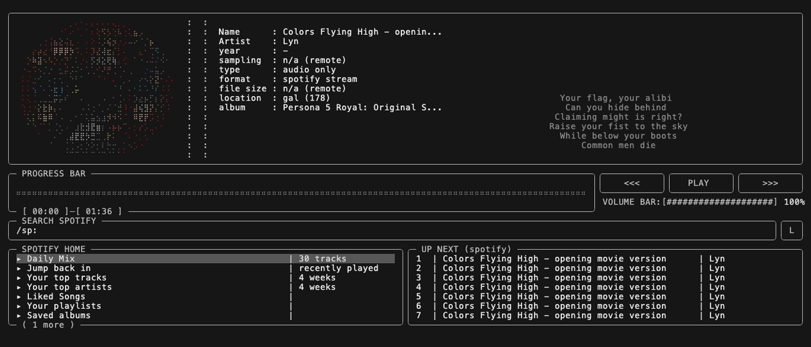

<div align="center">Mousiki 🎵

<p align="center">
  <a href="https://opensource.org/" target="_blank">
    
  </a>
  &nbsp;
  <a href="https://www.apache.org/" target="_blank">
    
  </a>
</p>


> [!NOTE]
> **Developer note:** Mousiki is released under the Apache License 2.0.
> You are free to use, modify, fork, re-distribute, and sell the software,
> subject to the terms of the license.


Mousiki is a terminal music player built from the ground up for people who prefer control, simplicity, and a keyboard. It's a fast, focused TUI (Terminal User Interface) without unnecessary interface layers — fully keyboard-driven and configurable, with spectrum visualizers, synced lyrics, online streaming, and a Spotify view, all without leaving your terminal.

``Personal preference is not a compromise—it's the design goal.``

> [!IMPORTANT]
> This repository is a fork of [itzender5820/mousiki](https://github.com/itzender5820/mousiki) that adds the
> **Spotify integration** — sign-in, home view, locally built Daily Mix, catalogue search, remote control of
> Spotify's own player, and album art on the spinning disk. Everything upstream still works exactly as before;
> the Spotify side is off by default and opt-in through `config.txt`.

## [FOR WIN32 CLICK HERE](https://github.com/StSchwerdtfeger/Mousiki-Windows-Native-Port)

## Preview



</div>

## ✨ Features

- **Local Music Playback:** Instantly browse and play your local music files.
- **Online Search & Streaming:** Search and stream tracks from YouTube via `yt-dlp` (`/s: <query>`), and download what you're streaming with `y`.
- **Spotify View:** Sign in with your own Spotify app, browse Daily Mix / Jump back in / top tracks / top artists / Liked Songs / playlists / saved albums, search the catalogue (`/sp:`), and drive playback on whatever Spotify client you own. See [Spotify](#-spotify) below.
- **Synced Lyrics:** Real-time, word-by-word active lyrics highlighting as the song plays, with a manual retry (`l`) when a fetch misses.
- **Visualizers:** Real-time FFT spectrum, waveform rendering, and a spinning Braille disk — which can spin the playing album's **cover art** instead of the built-in vinyl.
- **Queue Management:** Effortless queueing, shuffling, repeating, plus a bulk-add panel for pasting a whole YouTube playlist link.
- **Session Snapshot:** Autosave restores the exact track, position, queue, and playback toggles on the next launch.
- **Console / Logs Overlay:** `t` shows every external command Mousiki ran and its raw output — the same text that lands in the log file.
- **Highly Configurable:** Tweak colors, visualizer fluidity, animations, and hotkeys to match your exact workflow — from `config.txt` or the in-app Settings panel (`s`).

## 🚀 Supported Platforms

- **Native Support:** **Linux**, **macOS**, and **Android (Termux)**.
- **Unverified Support:** *Windows WSL*. (Support for Windows is currently not verified because I don't have the hardware access needed to test and debug on that operating system. If you try it out and get it working, feel free to contribute!)

## 🛠️ Getting Started
<div align="center">

## Default Keybindings

Configurable in `$HOME/.config/mousiki/config.txt`, or live from the Settings panel (`s`). Press `?` in-app for the cheatsheet, which always shows your *current* bindings.

### Search & Playback
| Action | Keybinding | Description |
| :--- | :--- | :--- |
| **Local Search** | `/` | Filter and search local library |
| **Online Stream Search** | `/s: <query>` | Search and stream music from YouTube |
| **Spotify Search** | `/sp: <query>` | Search the Spotify catalogue |
| **Spotify Home** | `S` | Daily Mix, playlists, top tracks, Liked Songs, … |
| **Download Stream** | `y` | Download currently streaming track |
| **Play / Pause** | `p` (or `ENTER`) | Toggle playback |
| **Next / Previous Track** | `n` / `b` | Skip between songs |
| **Seek** | `ARROW_LEFT` / `ARROW_RIGHT` | Seek backward / forward 5s |
| **Volume** | `1` / `2` | Increase / Decrease volume |
| **Mute** | `x` | Mute without pausing |
| **Shuffle / Repeat** | `m` | Cycle play mode (list / loop / shuffle / repeat queue / stop) |

### Navigation & Queue
| Action | Keybinding | Description |
| :--- | :--- | :--- |
| **Navigate** | `ARROW_UP` / `ARROW_DOWN` | Move selection |
| **Switch Tabs/Cards** | `TAB` | Cycle between UI panels |
| **Add to Queue** | `a` | Enqueue selected track (on the Queue panel: open Bulk Add) |
| **Remove from Queue** | `d` | Dequeue selected track |
| **Filter by Folder** | `f` | Apply folder filter |
| **Clear Filter** | `c` | Reset active search/filters |
| **Quit** | `q` | Exit application |

### Panels & Utilities
| Action | Keybinding | Description |
| :--- | :--- | :--- |
| **Settings** | `s` | Open the settings panel (colors, toggles, hotkeys) |
| **Cheatsheet** | `?` | Full key list with your current bindings |
| **Console / Logs** | `t` | Commands Mousiki ran and their raw output |
| **Retry Lyrics** | `l` | Re-fetch lyrics for the playing track |
| **Refresh UI** | `k` | Force a full redraw |

</div>

### Prerequisites & Installation

Mousiki relies on a few external tools for audio fetching, decoding, and lyrics. The easiest way to get started is by running the setup script on macOS (requires [Homebrew](https://brew.sh)), Debian-based Linux, or Termux:

```bash
# Clone the repository
git clone https://github.com/galuhbudhiswara/mousiki-spotify-integration.git
cd mousiki-spotify-integration

# Run the setup script (installs dependencies, sets up config, and builds the app)
bash setup.sh
```

If you're building manually, ensure you have `cmake`, a C++17 compiler, `ffmpeg`, `yt-dlp` (or let `setup.sh` fetch its standalone binary for you), and `libcurl` development headers (e.g. `libcurl4-openssl-dev` on Debian/Ubuntu) installed.

### Running the App

After a successful build, you can start the player with:
```bash
./build/mousiki
```

## 🎧 Spotify

Mousiki does **not** decode Spotify audio — those streams are DRM'd and the only sanctioned route to PCM is Spotify's own closed SDK. So the Spotify view is a **browser and remote control**: you pick a track here, and a Spotify client you own (desktop, phone, or speaker) renders it. Mousiki's own `/s:` YouTube search is untouched and still plays through Mousiki's decoder.

### Setup

1. Create a free app at the [Spotify Developer Dashboard](https://developer.spotify.com/dashboard) and copy its **Client ID**.
2. Add this exact Redirect URI to that app: `http://127.0.0.1:8350/callback`
3. Put the three keys in `$HOME/.config/mousiki/config.txt`:

```ini
SpotifyEnabled=true
SpotifyClientId=your_client_id_here
SpotifyForceWebApi=true
```

4. Launch Mousiki and press `S`. Sign-in runs the OAuth **PKCE** flow in your browser — no client secret involved. The token is stored at `$HOME/.config/mousiki/spotify_token.json` with mode `0600` and is only ever sent to `accounts.spotify.com`.

### Backends

| Backend | Platform | Controls | Library browsing |
| :--- | :--- | :--- | :--- |
| **Web API** | any | Any device on your account (Premium required) | ✅ playlists, albums, top tracks, search |
| **MPRIS / D-Bus** | Linux | The local desktop app | ❌ |
| **AppleScript** | macOS | The local desktop app | ❌ |

`SpotifyForceWebApi=true` wins outright; otherwise macOS picks AppleScript and Linux picks MPRIS, both falling back to the Web API when no desktop app is running. **The home view needs the Web API backend** — the local backends can only drive the desktop app and can't list your library. Reading playback state works on a free account; the transport controls need Premium.

### Good to know

- **The Daily Mix is Mousiki's own, not Spotify's.** Recommendations, Featured Playlists, Audio Features, and Spotify's algorithmic playlists (Discover Weekly, Release Radar, the real Daily Mixes) were closed on 2024-11-27 to apps registered from that date onward — which includes any Client ID you create today. So the mix is built locally from your top tracks and recently played, seeded on the date: the same 30 tracks all day, a different 30 tomorrow. Nothing is stored.
- **The visualizer and waveform render flat while Spotify owns playback.** Both are fed from Mousiki's audio callback, and Spotify's decoding produces no samples for it. Local files and `/s:` streams keep everything.
- **Album art on the disk** (`DiskAlbumArt=true`) dithers the playing album's cover into the same circular Braille silhouette the vinyl uses, coloured from the artwork itself unless you set `DiskAlbumColor=false`. Web API backend only, since it's the one backend that reports cover art. Covers are cached under `$HOME/.cache/mousiki/art`.
- **Polling:** `SpotifyPollInterval` (ms) controls how often playback state is re-read — floored at 1000, and at 5000 on the Web API backend to stay inside Spotify's rate limits. The progress bar interpolates between polls, so a longer interval costs accuracy on seek/skip, not smoothness.

## ⚙️ Configuration

Your configuration file will be automatically generated at `$HOME/.config/mousiki/config.txt`. From there, you have complete freedom to customize Mousiki.

### Adding Custom Music Paths
You can easily tell Mousiki where to look for your music. Simply add multiple `LocalMusicPath` entries in your `config.txt`:

```ini
# Add as many custom paths as you need:
LocalMusicPath=/custom/path
LocalMusicPath=/home/user/Music
```

### Keys worth knowing

| Key | Default | What it does |
| :--- | :--- | :--- |
| `DiskAlbumArt` | `true` | Spin the playing album's cover instead of the built-in vinyl (Spotify Web API only) |
| `DiskAlbumColor` | `true` | Colour that cover from the artwork itself instead of the disk gradient |
| `DiskRotationSpeed` | `0.25` | Disk angular velocity multiplier, `0.01`–`1.00` (the shipped `config.txt` value) |
| `Visualizer` / `ElimentWaveForm` / `ElimentLyrics` / `ElimentQueue` / `ElimentDisk` | `true` | Turn individual panels off |
| `LyricsAnimation` | `word by word` | `full`, `word by word`, `line by line`, `letter by letter`, `active line only`, `active word only` |
| `AutoSave` | `true` | Restore track/position/queue/toggles next launch (`$HOME/.cache/mousiki/snapshot/snapshot.json`) |
| `AutoPlayOnStart` | `false` | Start playing immediately on launch instead of waiting for a keypress |
| `ConsoleVerbosity` | `basic` | `basic` = every external command and its output; `verbose` adds internal/OS events |
| `ShowStatusMessages` | `true` | The one-line notifications at the bottom of the player view |
| `SpotifyEnabled` | `false` | Master switch for the Spotify view |

Every color, element toggle, animation, and hotkey has an entry in `config.txt`, and the file ships with inline comments explaining each one — have a read through it.

## 🙏 Attribution & Dependencies

Mousiki stands on the shoulders of giants. A huge thank you to the developers behind these awesome open-source projects that make Mousiki tick:

- **[Mousiki](https://github.com/itzender5820/mousiki) by [itzender5820](https://github.com/itzender5820):** the player this fork builds on.
- **[miniaudio](https://github.com/mackron/miniaudio):** An incredible single-file audio playback and capture library.
- **[kissfft](https://github.com/mborgerding/kissfft):** A wonderfully simple and lightweight real-input FFT library (powering the spectrum visualizer).
- **[yt-dlp](https://github.com/yt-dlp/yt-dlp):** The backend magic for our online search and streaming capabilities.
- **libcurl:** used directly (no Python) to fetch synced lyrics from Better Lyrics (primary) and [LRCLIB](https://lrclib.net) (fallback), to talk to the Spotify Web API, and to download cover art. yt-dlp handles all YouTube search/streaming; setup.sh installs its standalone binary, so no Python is needed for that either.
- **[FFmpeg](https://ffmpeg.org/):** The Swiss army knife of multimedia handling — also the decoder for album covers, so no image library is vendored.
- **[Spotify Web API](https://developer.spotify.com/documentation/web-api):** catalogue, library, and playback control. Mousiki is not affiliated with or endorsed by Spotify.

<div align="center">

## 📜 License

This project is open-sourced under the [Apache License 2.0](LICENSE). 

## Star History

<a href="https://www.star-history.com/?repos=itzender5820%2Fmousiki&type=date&legend=top-left">
  <picture>
    <source media="(prefers-color-scheme: dark)" srcset="https://api.star-history.com/chart?repos=itzender5820/mousiki&type=date&theme=dark&legend=top-left" />
    <source media="(prefers-color-scheme: light)" srcset="https://api.star-history.com/chart?repos=itzender5820/mousiki&type=date&legend=top-left" />
    
  </picture>
</a>

---
*Crafted with ❤️ for the terminal by [itzender5820](https://github.com/itzender5820) — Spotify integration by [galuhbudhiswara](https://github.com/galuhbudhiswara)*

</div>
